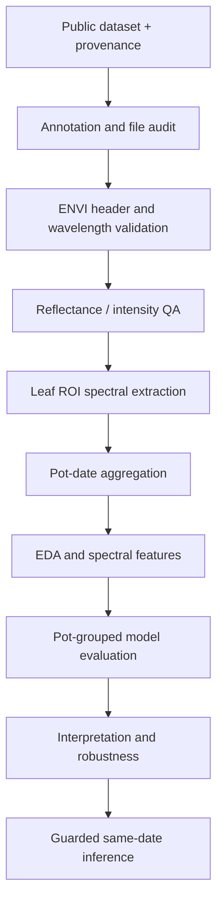

# TerraSpectra — Day 14 presentation outline

**Title:** TerraSpectra: Hyperspectral Analysis of Wheat Septoria Infection  
**Presentation length:** 7–8 minutes  
**Evidence status:** Methods and engineering progress; no verified real-data model results yet.

---

## Slide 1 — Title and research scope

**TerraSpectra**  
Hyperspectral Analysis of Wheat Septoria Infection

- VNIR + SWIR hyperspectral imaging
- Durum wheat and *Zymoseptoria tritici*
- Reproducible Python research pipeline

**Speaker note:** Introduce the project as a research pipeline to investigate spectral information associated with infection. Clarify that the current work is not a field-ready diagnostic or a validated forecasting model.

## Slide 2 — Why this problem matters

- Septoria tritici blotch affects wheat leaves.
- Visual symptom assessment can be subjective and time-consuming.
- Natural senescence can resemble disease-related necrosis.
- HSI captures spatial information across many wavelengths.

**Speaker note:** The dataset paper specifically notes that senescence complicated symptom assessment. HSI is promising, but the labels used for model training must still represent the biological outcome being claimed.

## Slide 3 — Public dataset profile

- 48 pots; two durum-wheat genotypes.
- 12 infected-treatment and 12 control pots per genotype.
- 18 acquisition dates from −1 to 20 DPI.
- 1,175 images and 3,326 leaves per modality, as reported by the paper.
- VNIR: 216 bands, 411–993 nm.
- SWIR: 256 bands, 964–2,494 nm.

**Visual suggestion:** Two sensor bands over a wavelength axis; label the 964–993 nm overlap. Do not use fabricated spectra.

**Speaker note:** These are publication-level dataset specifications. State that local file inventory and real headers remain to be verified.

## Slide 4 — The label problem

| Label concept | What it means |
|---|---|
| Infected/control treatment | Inoculation assignment |
| Observed symptom status | Independently assessed at a specific date |
| Future symptom status | Independently assessed at a later date |

**Speaker note:** Treatment assignment is not the same as visible disease. A classifier that predicts inoculation group is not automatically a symptom detector or a disease forecast.

## Slide 5 — End-to-end pipeline

**Speaker note:** Emphasize that the pipeline keeps raw files immutable, preserves provenance, and aggregates correlated observations before model evaluation.

## Slide 6 — Leakage prevention

- Pot is the conservative biological grouping unit.
- Both pot sides and every date from one pot stay together.
- One aggregated row per pot/date for analysis.
- Imputation, scaling, and feature selection fit inside training folds.
- Nested group-aware validation for model selection.

**Speaker note:** The paper describes 48 pots and treatment assignment at pot level. Counting thousands of leaves or pixels as independent samples would inflate the effective sample size and leak treatment-specific information across splits.

## Slide 7 — Models and evaluation plan

**Model families in the repository**
- Logistic Regression baseline
- RBF-SVM
- Random Forest
- Nested group-aware selection
- Matched VNIR / SWIR / fusion comparison

**Metrics**
- Balanced accuracy
- Macro-F1
- Per-class precision and recall
- Confusion matrix
- Fold-level variation and pot-level uncertainty

**Speaker note:** No model is declared best yet. Real-data evaluation begins only after annotation and spectral tables are verified.

## Slide 8 — Engineering progress

- Metadata and annotation audit utilities
- ENVI header inspection and calibration utilities
- Leaf ROI extraction scaffold
- Pot-date EDA and model workflows
- Forecast feasibility audit
- Guarded inference and robustness utilities

**Verified software evidence**
- Day 12 focused CI: passed.
- Day 13 focused CI: passed (six synthetic tests).
- These are software tests, not biological model results.

## Slide 9 — Robustness and interpretation

- Out-of-fold error analysis
- Permutation importance
- Band-ablation stress test
- Training-fold-scaled Gaussian-noise stress test

**Speaker note:** Explain that these methods are implemented but have not generated real-data wavelength rankings or biological robustness results. The noise experiment is a computational stress test, not a measured sensor-noise model.

## Slide 10 — Forecasting feasibility

**Current decision: NO-GO for a genuine future disease-outcome model.**

Required evidence:
- Stable biological identity
- Symptom-negative state at prediction origin for pre-symptomatic forecasting
- Independently assessed future symptom/severity label
- Assessment timestamp and documented method
- Chronological, group-held-out validation

**Speaker note:** Repeated image dates alone are not enough. The documented annotation description does not establish a complete future symptom-status table linked to each pot/date. Do not infer future labels from a cohort-level symptom-onset statement.

## Slide 11 — Current limitations

- Actual annotation CSVs and checksums not verified locally.
- Real ENVI cubes and ROI coordinate registration not validated.
- No real pot-date spectral table verified.
- No real-data model metrics or feature rankings.
- Controlled growth-chamber data; no field validation.
- Senescence can confound symptom assessment.

## Slide 12 — Conclusion and next steps

**What is complete:** A modular, documented, leakage-aware research software scaffold with focused synthetic CI checks.

**What must happen next:**
1. Verify annotation CSVs and checksums.
2. Inspect real VNIR/SWIR headers and coordinate overlays.
3. Extract and audit real ROI spectra.
4. Build verified pot-date features.
5. Run the predeclared evaluation and replace status-only slides with measured results.

**Closing statement:** TerraSpectra prioritizes reproducible evidence over an unsupported accuracy or forecasting claim.

---

## Reference slide

- Latchoumane et al. (2025), *Data in Brief*, 59, 111404. https://doi.org/10.1016/j.dib.2025.111404
- Dataset DOI: https://doi.org/10.57745/WVP0FJ
- Lowe et al. (2017), *Plant Methods*, 13, 80. https://doi.org/10.1186/s13007-017-0233-z
- Thomas et al. (2018), *Journal of Plant Diseases and Protection*, 125, 5–20. https://doi.org/10.1007/s41348-017-0124-6
